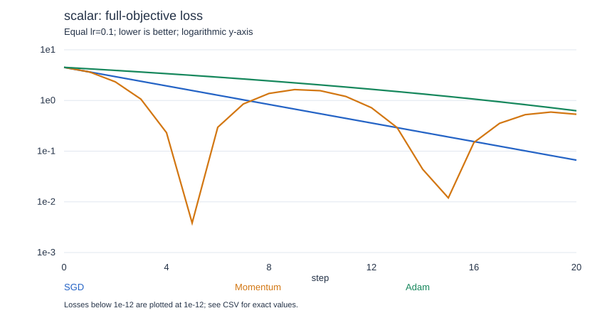
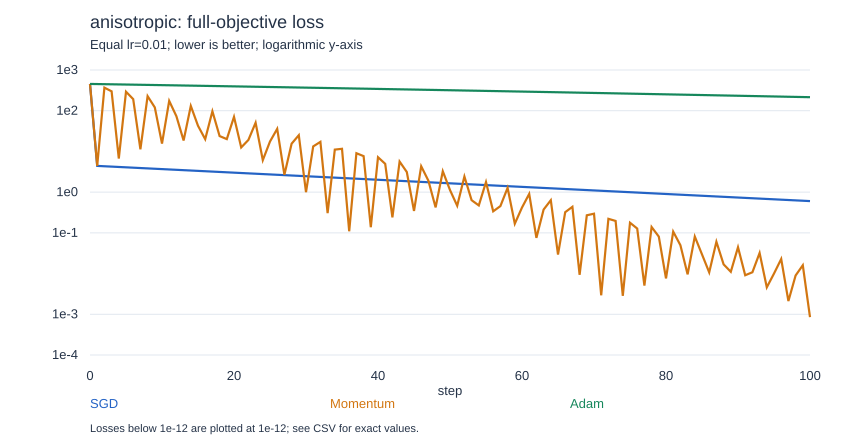
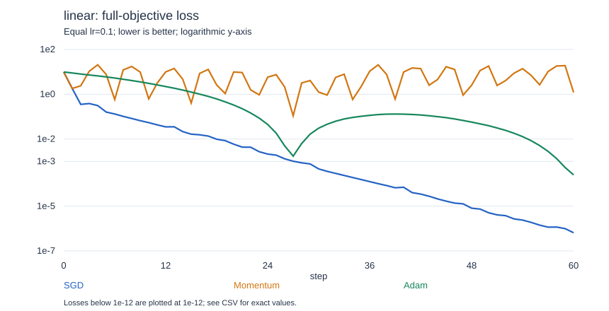

# 实际运行结果

由 run_experiment.py 生成。终端数值取近似；CSV 保留 Python float 精度。

随机种子：7；Adam betas=(0.9, 0.999)，eps=1e-8；Momentum mu=0.9。

step 表示更新次数；linear 每 3 步为一个 epoch。scalar/anisotropic 为确定性完整目标梯度，只有 linear 使用随机打乱的小批量。

三种优化器各自从相同参数及全零状态开始，重用相同批次顺序；梯度随各自的当前位置变化。

## 一维抛物线：L(w)=(w-3)^2/2

起点：`(0.0,)`；lr=0.1；更新 20 次。

| 优化器 | 初始损失 | 最终损失 | 最终参数 | 完成步数 | 状态 |
|---|---:|---:|---|---:|---|
| SGD | 4.5 | 0.0665139732 | w=2.63527004 | 20 | completed |
| Momentum | 4.5 | 0.534580426 | w=1.96599765 | 20 | completed |
| Adam | 4.5 | 0.626483945 | w=1.88063952 | 20 | completed |

### 同一学习率网格，每种优化器分别重置并尝试

每项使用相同步数和批次。以下选择的是该网格上**最终训练损失**最小的一项，不是通用最佳学习率。

| 优化器 | 网格中最佳 lr | 最终训练损失 |
|---|---:|---:|
| SGD | 1 | 0 |
| Momentum | 0.01 | 0.0624692949 |
| Adam | 1 | 0.113438633 |

## 二维尺度：L(x,y)=(x^2+100*y^2)/2

起点：`(3.0, 3.0)`；lr=0.01；更新 100 次。

| 优化器 | 初始损失 | 最终损失 | 最终参数 | 完成步数 | 状态 |
|---|---:|---:|---|---:|---|
| SGD | 454.5 | 0.602908537 | x=1.09809702, y=0 | 100 | completed |
| Momentum | 454.5 | 0.000851394315 | x=-0.00790104504, y=0.00405013841 | 100 | completed |
| Adam | 454.5 | 214.8111 | x=2.0624464, y=2.0624464 | 100 | completed |

### 同一学习率网格，每种优化器分别重置并尝试

每项使用相同步数和批次。以下选择的是该网格上**最终训练损失**最小的一项，不是通用最佳学习率。

| 优化器 | 网格中最佳 lr | 最终训练损失 |
|---|---:|---:|
| SGD | 0.018 | 0.118989892 |
| Momentum | 0.018 | 0.000753063558 |
| Adam | 0.3 | 0.0039196389 |

## 小批量线性回归：prediction=w*x+b

起点：`(0.0, 0.0)`；lr=0.1；更新 60 次。

| 优化器 | 初始损失 | 最终损失 | 最终参数 | 完成步数 | 状态 |
|---|---:|---:|---|---:|---|
| SGD | 9.83333333 | 6.47926741e-07 | w=2.0002061, b=0.998952325 | 60 | completed |
| Momentum | 9.83333333 | 1.20985266 | w=1.30309144, b=0.608603167 | 60 | completed |
| Adam | 9.83333333 | 0.00024947131 | w=1.99861417, b=1.0221355 | 60 | completed |

### 同一学习率网格，每种优化器分别重置并尝试

每项使用相同步数和批次。以下选择的是该网格上**最终训练损失**最小的一项，不是通用最佳学习率。

| 优化器 | 网格中最佳 lr | 最终训练损失 |
|---|---:|---:|
| SGD | 1 | 0 |
| Momentum | 0.03 | 0.000890308614 |
| Adam | 0.1 | 0.00024947131 |

## 如何解释

- 相同数值 lr 仅便于核对公式；SGD 乘当前梯度，Momentum 乘动量，Adam 乘经二阶矩归一化的一阶矩，实际步长不同。
- 同一批次不等于同一梯度：参数走到不同位置后，各自重新计算梯度。
- 曲线始终比较完整目标损失；linear 的批次损失另列在 CSV，不能混作统一比较指标。
- best_loss 包含 t=0，仅表示运行中最好值；网格选择始终按 final_loss。nonfinite 表示浮点溢出/非有限值并中止，不是严格的数学发散证明。
- 有限步数、选定起点、这一组学习率和无噪声小数据，不足以推出 Adam 一定优于 SGD，也不代表泛化能力、训练耗时或神经网络表现。
- 网格直接看训练目标，没有独立验证/测试集；本实验用于理解更新机制，不是模型选型基准。
